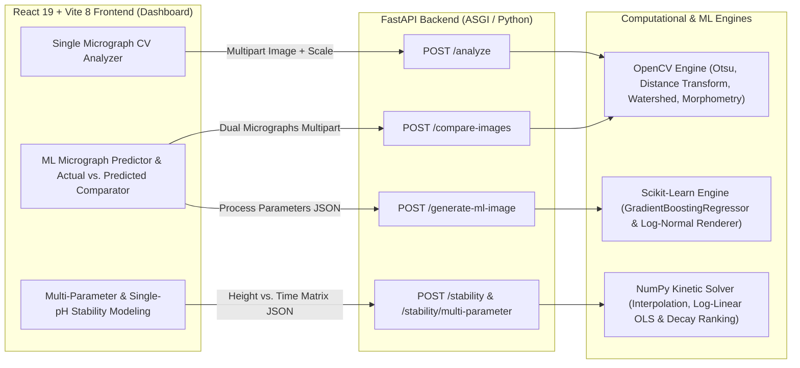

# Microbubble & Emulsion Stability Analysis Platform

An end-to-end **Computer Vision, Kinetic Modeling, and Machine Learning** platform developed as part of an Undergraduate Project (UGP) to characterize micro-scale emulsion droplet morphology from optical micrographs and model macro-scale emulsion stability across formulation and processing parameters.

---

## 1. Project Overview

Emulsions and microbubble dispersions are thermodynamically unstable systems whose macroscopic shelf-life (resistance to creaming, sedimentation, flocculation, and coalescence) is governed by their microscopic droplet size distribution. Accurately quantifying both scales traditionally requires manual measurement of hundreds of droplets under a microscope alongside manual curve fitting of phase-separation heights over days.

This project unifies both scales into a single analytical platform:

- **Micro-Scale Characterization (Computer Vision):** Automates droplet detection, de-clumping of touching microbubbles via marker-controlled Watershed segmentation, spatial unit calibration ($\mu\text{m}/\text{px}$), diameter distribution histograms, and Polydispersity Index (PDI) evaluation.
- **Macro-Scale Kinetic Modeling:** Quantifies emulsion stability from experimental emulsion-band height measurements over time using first-order exponential decay kinetics ($h(t) = h_0 e^{-kt}$), estimating decay rate constants ($k$), half-lives ($t_{1/2}$), height retention percentages, and stability classes.
- **Multi-Parameter Comparative Studies:** Enables side-by-side kinetic analysis across systematic variations in **Homogenizer Speed (RPM)**, **Mixing Duration**, **pH**, and custom formulation variables via an interactive spreadsheet interface.
- **Machine Learning Micrograph Synthesis & Validation:** Trains Gradient Boosted Regression Trees on laboratory experimental measurements to predict droplet morphology from process parameters, generates realistic synthetic micrographs, and performs side-by-side **Actual vs. Predicted** statistical and visual comparisons.

---

## 2. Summary of Work Completed

1. **Automated Microbubble Segmentation & Sizing**
   - Implemented an OpenCV image-processing pipeline combining Gaussian denoising, Otsu automatic thresholding, morphological opening, Euclidean distance transforms, and **Watershed segmentation** to isolate overlapping/touching microbubbles.
   - Added physical scale calibration (`scale` in unit/pixel, e.g., $0.5\ \mu\text{m/px}$ calibrated from a $50\ \mu\text{m} = 100\ \text{px}$ microscope scale bar) supporting $\mu\text{m}$, $\text{nm}$, $\text{mm}$, $\text{cm}$, $\text{m}$, and $\text{px}$.
   - Built interactive **Bubble Size Distribution** histograms and **Bubble Diameter vs. Index** scatter plots.

2. **Multi-Parameter Comparative Stability Grid**
   - Designed an Excel-style dynamic matrix in the web UI where users select a parameter to vary (**Homogenizer RPM**, **Mixing Time**, **pH Levels**, or **Custom Parameter**), add/remove time columns and condition rows, and fit all conditions simultaneously.
   - Implemented generalized multi-point log-linear Ordinary Least Squares (OLS) regression to compute $h_0$, $k$, $t_{1/2}$, retention $\%$, and goodness-of-fit ($R^2$), automatically ranking conditions to identify the most stable formulation.

3. **ML Micrograph Generator & Actual vs. Predicted Comparison**
   - Trained `GradientBoostingRegressor` models on laboratory RPM ($5000\text{–}25000\ \text{RPM}$), mixing time ($1\text{–}4\ \text{min}$), and pH datasets to predict mean droplet diameter ($\mu$) and standard deviation ($\sigma$).
   - Built a log-normal circle-packing synthetic micrograph engine with 3D spherical intensity shading that saves generated micrographs automatically for testing.
   - Implemented an **Actual vs. Predicted Microscopic Image Comparison** workflow computing **Actual PDI**, **Predicted PDI**, **PDI Difference**, **Actual Mean Diameter**, **Predicted Mean Diameter**, **Mean Diameter Difference**, side-by-side micrograph/mask inspection, downloadable composite figures, and overlaid relative-frequency size distribution charts.

---

## 3. Scientific Theory & Mathematical Formulations

### 3.1 Computer Vision & Droplet Morphometry

#### 1. Preprocessing & Otsu's Automatic Binarization
An input BGR micrograph is converted to single-channel grayscale intensity $I(x, y) \in [0, 255]$ and smoothed with a $7 \times 7$ Gaussian filter (in the Watershed pipeline) to suppress high-frequency sensor noise:

$$I_{\text{blur}}(x, y) = (I * G_{\sigma})(x, y)$$

**Otsu's method** automatically selects the global intensity threshold $T^*$ that maximizes the between-class variance $\sigma_B^2(T)$ separating foreground droplets from background:

$$\sigma_B^2(T) = \omega_0(T)\,\omega_1(T)\,\big[\mu_0(T) - \mu_1(T)\big]^2, \qquad T^* = \arg\max_{0 \le T \le 255} \sigma_B^2(T)$$

where $\omega_0, \omega_1$ are the cumulative class probabilities and $\mu_0, \mu_1$ are the mean intensities of the two classes.

#### 2. Morphological Denoising & Marker-Controlled Watershed
Small binary artifacts are removed via morphological opening ($\circ$) using a $3 \times 3$ structuring element $K$:

$$B_{\text{open}} = (B \ominus K) \oplus K$$

In dense emulsions where droplets touch one another, simple connected-component labeling would merge adjacent spheres into a single contour. To separate touching microbubbles:
1. **Sure Background ($B_{\text{bg}}$):** Morphological dilation of $B_{\text{open}}$.
2. **Euclidean Distance Transform ($D$):** Computes the $L_2$ distance from every foreground pixel $(x, y)$ to the nearest zero (background) pixel:
   $$D(x, y) = \min_{(x', y') \in B_{\text{open}}^c} \sqrt{(x - x')^2 + (y - y')^2}$$
3. **Sure Foreground Seeds ($B_{\text{fg}}$):** Thresholding the distance map at $0.5 \max(D)$ isolates the distinct centers of individual spherical droplets:
   $$B_{\text{fg}}(x, y) = \begin{cases} 255, & D(x, y) > 0.5 \max(D) \\ 0, & \text{otherwise} \end{cases}$$
4. **Watershed Flooding:** Connected components of $B_{\text{fg}}$ act as catchment basin markers, and the unknown boundary region $U = B_{\text{bg}} - B_{\text{fg}}$ is flooded via `cv2.watershed` to locate exact Ridge/Dam boundaries between touching bubbles.

#### 3. Area-Equivalent Spherical Diameter & Spatial Calibration
For each segmented droplet region $i$ with pixel area $A_i$ (filtered above noise threshold $A_{\min}$), the **area-equivalent circular diameter** in pixels and calibrated physical diameter are computed from $A = \frac{\pi}{4} d^2$:

$$d_{i,\text{px}} = \sqrt{\frac{4 A_i}{\pi}}, \qquad d_i = s \cdot d_{i,\text{px}}$$

where $s$ is the spatial calibration factor (physical units per pixel, e.g., $s = \frac{50\ \mu\text{m}}{100\ \text{px}} = 0.5\ \mu\text{m/px}$).

---

### 3.2 Polydispersity Index (PDI) & Size Uniformity

Given $N$ detected droplets $\{d_1, d_2, \dots, d_N\}$, the sample mean diameter $\mu$ and standard deviation $\sigma$ are:

$$\mu = \frac{1}{N} \sum_{i=1}^{N} d_i, \qquad \sigma = \sqrt{\frac{1}{N} \sum_{i=1}^{N} (d_i - \mu)^2}$$

The dimensionless **Polydispersity Index (PDI)** quantifies the breadth (heterogeneity) of the droplet size distribution:

$$\text{PDI} = \left(\frac{\sigma}{\mu}\right)^2$$

- **$\text{PDI} < 0.05$:** Highly monodisperse emulsion (uniform droplet size; minimal Laplace pressure gradient between droplets, resisting Ostwald ripening).
- **$0.05 \le \text{PDI} \le 0.20$:** Narrow to moderate size distribution typical of well-homogenized laboratory emulsions.
- **$\text{PDI} > 0.20$:** Broad/polydisperse distribution indicating incomplete droplet breakup, multimodal satellite droplets, or shear-induced re-coalescence.

Notice that $\text{PDI}$ is **scale-invariant**: multiplying all diameters by any calibration constant $s > 0$ leaves $(\sigma / \mu)^2$ unchanged.

---

### 3.3 Macro-Scale Emulsion Stability & Decay Kinetics

#### 1. Physical Link Between Droplet Size and Phase Separation (Stokes' Law)
In dilute gravitational creaming or sedimentation, the terminal velocity $v_s$ of a droplet of diameter $d$ in a continuous phase of viscosity $\eta$ and density contrast $\Delta \rho$ follows **Stokes' Law**:

$$v_s = \frac{\Delta \rho \, g \, d^2}{18 \eta}$$

Because phase-separation velocity scales quadratically with droplet diameter ($v_s \propto d^2$), formulations with smaller mean diameter $\mu$ and lower $\text{PDI}$ exhibit substantially slower creaming/coalescence and longer macroscopic stability.

#### 2. First-Order Exponential Decay Model
The height of the opaque emulsion layer $h(t)$ as phase separation progresses over time $t$ is modeled as a first-order exponential decay process:

$$h(t) = h_0 \, e^{-kt}$$

where:
- $h_0$ is the extrapolated initial emulsion height at $t = 0$,
- $k \ge 0$ is the first-order kinetic decay rate constant ($\text{min}^{-1}$, converted to $\text{h}^{-1} = 60k$ and $\text{day}^{-1} = 1440k$).

#### 3. Parameter Estimation: Two-Point Analytical Solution vs. Multi-Point OLS
- **Case A — Two Experimental Time Points ($M = 2$):**
  For a target pH clamped to $[1.5, 12.0]$, $h_1(\text{pH})$ and $h_2(\text{pH})$ are obtained via piecewise linear interpolation:
  $$h_m(\text{pH}) = h_{m,j} + \frac{\text{pH} - \text{pH}_j}{\text{pH}_{j+1} - \text{pH}_j}\,(h_{m,j+1} - h_{m,j}), \qquad \text{pH}_j \le \text{pH} \le \text{pH}_{j+1}$$
  If $h_2 < h_1$, solving $h_1 = h_0 e^{-k t_1}$ and $h_2 = h_0 e^{-k t_2}$ analytically yields:
  $$k = \frac{\ln(h_1 / h_2)}{t_2 - t_1}, \qquad h_0 = h_1 \, e^{k t_1}$$
  If $h_2 \ge h_1$ (no measurable height loss over the observation window), $k = 0$ and the emulsion is classified as steady/highly stable.

- **Case B — Multiple Time Periods ($M \ge 3$ in the Multi-Parameter Grid):**
  Linearizing the exponential law by taking the natural logarithm gives:
  $$\ln h(t_i) = \ln h_0 - k t_i$$
  Ordinary Least Squares (OLS) linear regression on $\{(t_i, \ln h_i)\}_{i=1}^{M}$ yields slope $m$ and intercept $c$:
  $$m = \frac{\sum_{i=1}^{M}(t_i - \bar{t})(\ln h_i - \overline{\ln h})}{\sum_{i=1}^{M}(t_i - \bar{t})^2}, \qquad c = \overline{\ln h} - m \bar{t}$$
  $$k = \max(0, -m), \qquad h_0 = e^{c}$$
  Goodness-of-fit in log-space is quantified via the **coefficient of determination ($R^2$)**:
  $$R^2 = 1 - \frac{\text{SS}_{\text{res}}}{\text{SS}_{\text{tot}}} = 1 - \frac{\sum_{i=1}^{M} \big(\ln h_i - (c + m t_i)\big)^2}{\sum_{i=1}^{M} \big(\ln h_i - \overline{\ln h}\big)^2}$$

#### 4. Half-Life ($t_{1/2}$), Height Retention, and Stability Classification
The **emulsion half-life** $t_{1/2}$ is the time required for the emulsion band height to decay to half its initial value ($h(t_{1/2}) = h_0 / 2$):

$$\frac{h_0}{2} = h_0 e^{-k t_{1/2}} \implies t_{1/2} = \frac{\ln 2}{k}$$

The **height retention percentage** at the final measured time point is:

$$\text{Retention (\%)} = \frac{h_{\text{final}}}{h_0} \times 100$$

Qualitative stability classes are assigned from $t_{1/2}$ (converted to days, $t_{1/2,\text{days}} = t_{1/2,\text{min}} / 1440$):

---

### 3.4 Turbulent Shear Breakup, ML Regression & Synthetic Micrograph Modeling

#### 1. Physical Dependence on Homogenizer Speed, Mixing Time, and pH
In rotor–stator turbulent homogenization (Hinze–Kolmogorov theory), maximum stable droplet diameter scales inversely with turbulent energy dissipation rate $\varepsilon \propto N_{\text{RPM}}^3 D_{\text{rotor}}^2$, giving $d_{\max} \propto \text{We}_{\text{crit}}^{3/5} \propto N_{\text{RPM}}^{-6/5}$ up to an asymptotic shear limit where excessive energy input can induce over-processing and broader polydispersity. Similarly, neutral pH ($\sim 6\text{–}7$) maximizes interfacial stability in the tested system, whereas extreme acidic ($\text{pH } 1.5$) or alkaline ($\text{pH } 12$) conditions accelerate droplet coalescence.

#### 2. Gradient Boosted Regression Trees (`GradientBoostingRegressor`)
Two ensemble tree regressors ($\hat{f}_{\mu}$ for mean diameter in $\mu\text{m}$ and $\hat{f}_{\sigma}$ for standard deviation in $\mu\text{m}$) are trained over feature vector $\mathbf{x} = [\text{RPM},\ t_{\text{mix}},\ \text{pH}]^\top$ with elevated sample weights on direct laboratory observations so experimental anchor conditions are reproduced accurately while generalizing smoothly across intermediate inputs.

#### 3. Actual vs. Predicted Comparison Metrics
Both the experimental micrograph and ML-predicted micrograph are segmented identically via Otsu thresholding + $3 \times 3$ morphological opening + 8-connected component analysis (`cv2.connectedComponentsWithStats`), comparing:

$$\Delta \text{PDI} = \big|\text{PDI}_{\text{actual}} - \text{PDI}_{\text{predicted}}\big|, \qquad \Delta \mu = \big|\mu_{\text{actual}} - \mu_{\text{predicted}}\big|$$

---

## 4. System Architecture & Technical Analysis

### 4.1 Architecture Diagram



### 4.2 Backend Technical Analysis

- **Framework & Concurrency:** Built on **FastAPI** + **Uvicorn**, using **Pydantic** models (`StabilityRequest`, `MultiParameterRequest`, `GenerateMLImageRequest`) for strict request schema validation and automatic OpenAPI generation (`/docs`).
- **Image Processing (`opencv-python-headless` & `numpy`):**
  - Headless OpenCV avoids GUI/X11 binary overhead while executing vectorized C++ routines (`cv2.GaussianBlur`, `cv2.threshold`, `cv2.morphologyEx`, `cv2.distanceTransform`, `cv2.watershed`, `cv2.connectedComponentsWithStats`).
  - Processed contour overlays, grayscale micrographs, and binary segmentation masks are encoded in-memory to JPEG/PNG buffers via `cv2.imencode` and returned as Base64 strings, eliminating stateful static-file serving dependencies while ensuring temporary upload files are deterministically cleaned up in `finally` blocks.
- **Machine Learning (`scikit-learn`):**
  - `GradientBoostingRegressor` models (`ML_MEAN_MODEL`, `ML_STD_MODEL`) are trained once in-memory at module initialization (<50 ms startup overhead), making `/generate-ml-image` inference sub-millisecond before vectorized NumPy patch rendering.

### 4.3 Frontend Technical Analysis

- **Stack:** **React 19** bundled with **Vite 8** and styled with **Tailwind CSS v4** (`@tailwindcss/vite`) and Chart.js canvases.
- **Data Visualization (`chart.js` + `react-chartjs-2`):**
  - Supports **Bar** charts (single-image histograms and grouped Actual vs. Predicted relative-frequency/count distributions), **Scatter** charts (per-bubble diameter distribution), and multi-series **Line** charts combining continuous fitted exponential curves ($h(t) = h_0 e^{-kt}$) with discrete experimental point markers across selectable time horizons.
- **Client-Side Composite Export:** Uses an offscreen HTML5 `<canvas>` pipeline to render side-by-side labeled **Actual Microscopic Image** and **ML Predicted Image** panels into a downloadable PNG figure directly in the browser.

### 4.4 API Reference

| Method & Endpoint | Content-Type | Inputs | Key Outputs |
| :--- | :--- | :--- | :--- |
| `POST /analyze` | `multipart/form-data` | `file`, `scale`, `unit` | `count`, `avg`, `std`, `diameters`, `hist_counts`, `bin_edges`, contour-annotated `image` (Base64) |
| `POST /stability` | `application/json` | `{ "pH": float }` | `h1`, `h2`, `half_life` (min/h/days), `stability_class`, `decay_constant`, `equation_days`, `curves` (`48h`, `7d`, `14d`, `full`) |
| `POST /stability/multi-parameter` | `application/json` | `parameter_name`, `parameter_unit`, `time_unit`, `height_unit`, `conditions[]` | Per-condition kinetic parameters (`initial_height`, `retention_pct`, `decay_constant_per_day`, `half_life_days`, `r2`, `stability_class`, `curves`), `best_condition` |
| `POST /generate-ml-image` | `application/json` | `rpm`, `mixing_time`, `ph`, `scale_um_per_px`, `width`, `height`, `seed` | `predicted_mean_um`, `predicted_std_um`, `extracted_mean_px`, `extracted_pdi`, `predicted_image` (Base64), auto-saved PNG copies |
| `POST /compare-images` | `multipart/form-data` | `actual_file`, `predicted_file`, `invert_actual`, `invert_predicted` | `actual_pdi`, `predicted_pdi`, `pdi_difference`, `actual_mean`, `predicted_mean`, `mean_difference`, `actual_image`, `predicted_image`, binary masks, shared-bin histograms |

### 4.5 Engineering Trade-offs & Challenges Addressed

1. **Diffuse Phase Interfaces in Experimental Vials:** Gradual creaming creates a diffuse transition zone rather than a razor-sharp boundary, introducing measurement variance at individual time points. Moving from 2-point estimation to multi-point log-linear OLS regression with $R^2$ reporting smooths single-point reading noise across the full time series.
2. **Touching Droplets & Refractive Borders in Brightfield Microscopy:** Optical micrographs exhibit dark refractive rings around bright droplet cores and frequent droplet-droplet contact. Providing Watershed distance-transform segmentation for dense micrographs alongside configurable polarity (`invert`) for Otsu connected-component comparison handles both bright-core and dark-droplet imaging modes.

---

## 5. Repository Structure

```text
UGP/
├── fast-api/
│   ├── main.py                  # FastAPI application: CV, Stability Kinetics & ML Micrograph APIs
│   └── requirements.txt         # Backend Python dependencies
├── frontend/
│   ├── src/
│   │   ├── App.jsx              # Main React dashboard
│   │   ├── index.css            
│   │   └── main.jsx 
│   ├── package.json             # Frontend dependencies & Vite scripts
│   └── vite.config.js           
├── microscopic image.png        # Sample experimental laboratory micrograph (50 µm scale bar)
├── RPM_variation.png            # Reference experimental micrographs across 5000–25000 RPM
├── mixing_time_variation.png    # Reference experimental micrographs across 1–4 min mixing
└── README.md                    # Project documentation, theory, equations & technical analysis
```

---

## 6. Installation & Running the Application

### Prerequisites
- **Python** 3.10+
- **Node.js** 18+ and **npm**

### 1. Start the FastAPI Backend
```bash
cd fast-api
pip install -r requirements.txt
python -m uvicorn main:app --reload --host 127.0.0.1 --port 8000
```
The API server runs at `http://127.0.0.1:8000` (interactive Swagger docs at `http://127.0.0.1:8000/docs`).

### 2. Configure & Start the React Frontend
Create a `.env` file inside `frontend/` (if not already present):
```env
VITE_API_URL=http://127.0.0.1:8000
```
Then install dependencies and launch the development server:
```bash
cd frontend
npm install
npm run dev
```
Open `http://localhost:5173` in your browser to access the dashboard.
